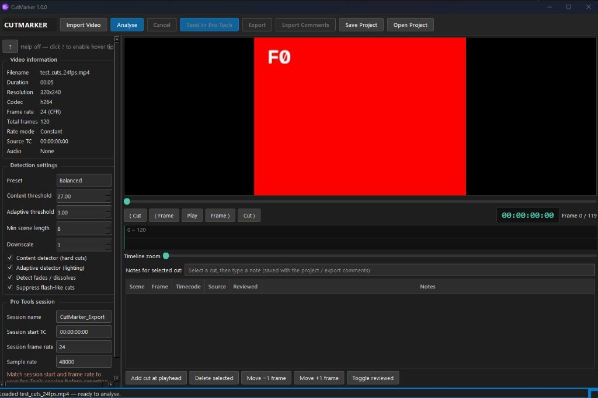

#  CutMarker

**Automatic film cut detection and Pro Tools marker generator** for Windows sound post-production.

CutMarker analyses a finished picture file, finds every camera cut, and creates sequential **SCENE n** markers that land on the first frame of each new shot. Markers go into Pro Tools either live via **PTSL**, or as a **CSV** you enter by hand.

Runs fully offline. No cloud upload, no subscription.

## Download

Get the latest build from **[Releases](https://github.com/Alexh2oo4/CutMarker/releases)**:

| Asset | What’s in it |
| --- | --- |
| **CutMarker-windows.zip** | Ready-to-run app: `CutMarker.exe` plus the `_internal` folder. Unzip and run the exe. Keep `_internal` next to the exe. |
| **Source code** | For developers. See **SETUP.txt** in the zip for install and run steps. |

## Features

- Import MOV / MP4 / MXF / AVI / MKV and common codecs (ProRes, H.264, H.265, …) via FFmpeg
- Frame-rate aware metadata (23.976–60 fps, CFR/VFR detection, source timecode when present)
- PySceneDetect-based cut detection with Sensitive / Balanced / Conservative presets
- Flash suppression and optional fade detection
- Frame-accurate preview, timeline, and scene list
- Manual add / delete / nudge cuts with automatic SCENE renumbering
- **Send to Pro Tools** — Absolute Memory Locations via PTSL (preferred)
- Export CSV for manual marker entry in Pro Tools (also EDL / text report)
- Save / reopen `.cutmarker.json` projects without re-analysing

## Getting markers into Pro Tools

CutMarker does **not** write proprietary `.ptx` session files, and **Session Info as Text (`.txt`) is not a supported import path**. Pro Tools will not reliably import CutMarker markers from a `.txt` file via *Import Session Data*.

Use one of these two workflows:

### 1. Send to Pro Tools (PTSL) — recommended

Creates real **Absolute** Memory Location markers in the open session.

1. Match CutMarker’s **session start timecode** and **session frame rate** to your Pro Tools session.
2. Open Pro Tools with your session loaded. Enable scripting / PTSL (Pro Tools 2023.6+).
3. In CutMarker, click **Send to Pro Tools**.
4. Markers appear as `SCENE 1`, `SCENE 2`, … without replacing your audio.

### 2. Export CSV — manual entry

1. Click **Export** and save as **CSV**.
2. Open the file in Excel / Sheets (scene number, name, frame, timecode, timestamp, frame rate).
3. In Pro Tools, create Memory Locations / markers by hand using those timecodes (or paste values into whatever spreadsheet → PT workflow you use).

CSV is for review, handoff, and manual entry. It is **not** auto-imported by Pro Tools.

## Requirements

- Windows 10 or 11
- For **Send to Pro Tools**: Pro Tools 2023.6+ with PTSL / scripting enabled

## Workflow notes

- Every camera cut becomes a new sequential scene (`SCENE 1` = first shot at frame 0).
- Prefer **downscale = 1** (full resolution) for final passes; raise it only to speed long features.
- VFR sources trigger an on-screen warning — verify markers against picture.
- If source fps ≠ session fps, markers are mapped through exact rational seconds then rounded to the nearest session frame.

## Screenshot

